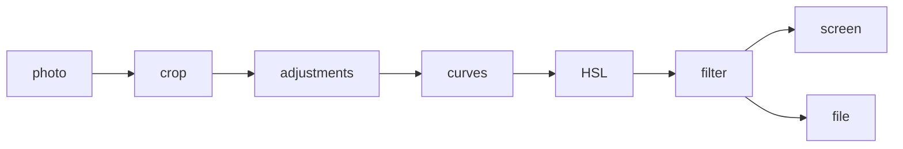

# expo-photo-engine

[](https://www.npmjs.com/package/@fladioarmandika/expo-photo-engine) [](https://github.com/FladioArmandika/expo-photo-engine/actions/workflows/ci.yml) [](LICENSE)

A photo editor engine for Expo. You build the UI, it does the pixels.

Sliders, filter strips, crop handles: all yours, in your own design. The engine draws the live
preview and the full-size export on the GPU, and iOS and Android come out the same.

```tsx
const editor = usePhotoEditor();

<PhotoCanvas source={uri} style={{ flex: 1 }} {...editor.canvasProps} />
<Slider {...editor.sliderProps('exposure')} />
<Button title="Undo" disabled={!editor.canUndo} onPress={editor.undo} />
<Button title="Save" onPress={() => exportImage(uri, editor.getEdits(), { format: 'jpeg' })} />
```

Dragging a slider doesn't re-render your component. Each value goes straight to the GPU, and each
drag is one undo step. On an iPhone it holds 60 fps on a 24.5MP photo.

## Why not a pop-up editor?

Most photo editors for React Native work like this: you call `open(path)`, their full-screen UI
takes over your app, and you get a flat image back. You can't restyle it, it looks different on
iOS and Android, and the user can't change their mind later.

| | Pop-up editors | expo-photo-engine |
| --- | --- | --- |
| UI | Theirs, full screen | Yours, any layout |
| iOS vs Android | Two different editors | One shader, same pixels |
| What you get back | A flat image | JSON edits you can reopen later, plus an export |
| Undo | Inside their UI | Yours |
| Export without showing anything | No | Yes |

The last real filter toolkit,
[react-native-image-filter-kit](https://github.com/iyegoroff/react-native-image-filter-kit), stopped
in 2022.

## What's in it

- **Adjustments:** exposure, contrast, highlights, shadows, saturation, vibrance, warmth, tint,
  sharpness, vignette.
- **HSL:** hue, saturation and luminance for 8 color ranges.
- **Tone curves:** RGB plus red, green and blue, with a ready-made curve editor.
- **Filters:** 11 built in, your own as plain data, and thumbnails rendered on the actual photo.
- **Crop:** rotate, flip, straighten, aspect lock, and an optional crop box with handles.
- **Hold to compare** with the original.
- **Export** to JPEG, PNG or HEIC at full size, keeping the camera metadata (GPS optional).
- **Edits are JSON.** Save them anywhere and reopen the photo with everything still adjustable.

## Some things you can do

**Darken the sky without touching the rest.**

```ts
editor.setHsl('blue', 'luminance', -0.5);
```

**Fade the blacks for a film look.**

```ts
editor.setCurve('rgb', [[0, 0.1], [1, 1]]);
```

**Show the original while the photo is held.**

```tsx
<Pressable {...editor.compareProps}>
  <PhotoCanvas source={uri} {...editor.canvasProps} />
</Pressable>
```

**Save the edits and open them again next week.**

```ts
const json = serializeEditStack(editor.edits); // store it anywhere

// next week
const editor = usePhotoEditor({ initialEdits: json });
```

**Make a filter picker that shows the real photo.**

```ts
const thumbs = await renderFilterThumbnails(uri, editor.getEdits(), { maxDimension: 160 });
// [{ id: null, label: 'Original', uri }, { id: 'vivid', label: 'Vivid', uri }, ...]
```

## Install

```sh
npx expo install @fladioarmandika/expo-photo-engine
```

It has native code, so it needs a
[development build](https://docs.expo.dev/develop/development-builds/introduction/), not Expo Go.

Needs Expo SDK 58+ (React Native 0.88+) with the New Architecture, iOS 16.4+ and Android 7.0+.

<details>
<summary>Bare React Native</summary>

Set up [Expo Modules](https://docs.expo.dev/bare/installing-expo-modules/) first, then:

```sh
npm install @fladioarmandika/expo-photo-engine
npx pod-install
```

</details>

## API

<details>
<summary><code>&lt;PhotoCanvas&gt;</code>: the native view</summary>

| Prop | What it does |
| --- | --- |
| `source` | `file://` URI or path of a JPEG, HEIC or PNG. `content://` works on Android. |
| `edits` | The edits to show. `usePhotoEditor` fills this in for you. |
| `previewQuality` | `auto` (default) sizes the preview to the view. `fast` is half that. `full` is full size, up to the GPU's limit. With `auto` and `fast`, a tight crop gets a sharper preview (up to 4096px) when the drag ends. |
| `onLoad` | Photo size, preview size and decode time. |
| `onError` | Decode or GPU errors. |
| `onRenderStats` | About twice a second while drawing: fps, CPU and GPU time (GPU on iOS only), input latency, sizes. |

Ref methods, none of which re-render anything: `setAdjustment(key, value)` (fine on every slider
tick), `setEdits(stack)`, and `beginInteraction()` / `endInteraction()` around a gesture.

</details>

<details>
<summary><code>usePhotoEditor(options?)</code>: edits, undo and slider wiring</summary>

```ts
const editor = usePhotoEditor({
  initialEdits: saved, // a stack or a saved one, any version, object or JSON string
  historyLimit: 100,
});
```

| Member | What it does |
| --- | --- |
| `canvasProps` | Spread onto `<PhotoCanvas>`. |
| `edits` | The committed edits. Save these. |
| `getEdits()` | The edits including a drag in progress. Use this for export. |
| `canUndo`, `canRedo`, `undo()`, `redo()` | History. |
| `isDirty`, `markSaved()` | Unsaved changes since the start or the last `markSaved()`. |
| `sliderProps(key)` | Range, value and callbacks for `@react-native-community/slider` or any slider with the same callbacks. |
| `setAdjustment(key, value)` | Sets one adjustment. |
| `hslSliderProps(color, channel)`, `setHsl(color, channel, value)` | One HSL value, -1 to 1. |
| `curveEditorProps(channel)`, `setCurve(channel, points)` | One tone curve. `null` removes it. |
| `setFilter(filter)`, `filterSliderProps()`, `setFilterIntensity(value)` | The filter and its strength, 0 to 1. |
| `setCrop(crop)`, `update(change)` | Change the crop, or apply any change like `update(rotateRight)`. |
| `setCropping(on)`, `cropping`, `cropOverlayProps(photo)` | Crop mode, for use with `<CropOverlay>`. |
| `compareProps`, `comparing`, `setComparing(on)` | Hold to compare. A quick tap is ignored, so it doesn't flicker. |
| `beginGesture()`, `endGesture()` | Everything in between is one undo step. For your own gesture code. |
| `setEdits(stack)`, `reset(stack?)` | Replace everything. `reset` also clears the history. |

Each slider or editor drag is one undo step, and so is each call made outside a drag. The logic
lives in `PhotoEditorController`, a plain class, if you want it outside React.

</details>

<details>
<summary><code>exportImage(source, edits, options?)</code>: save a file</summary>

```ts
const { uri, width, height } = await exportImage(source, edits, {
  format: 'jpeg',     // 'png' | 'jpeg' | 'heic'
  quality: 0.92,
  maxDimension: 4096, // 0 = full size
  metadata: 'all',    // 'all' | 'no-location' | 'none'
});
```

It uses the same shaders as the preview, so it looks the same, and it works without a view on
screen. The file keeps the original's camera, lens, date and copyright info, and its location
unless you pass `no-location`. HEIC needs an iPhone 7 or newer, or Android 9 or newer.

`renderThumbnails(source, stacks, options)` makes small JPEGs, one per stack, decoding the photo
only once. `renderFilterThumbnails` is the filter-picker version of it.

</details>

<details>
<summary>Adjustments</summary>

| Key | Range | What it does |
| --- | --- | --- |
| `exposure` | -3 to 3 | Brightness in stops, like a camera. |
| `contrast` | -1 to 1 | More punch, or flatter towards gray. |
| `highlights` | -1 to 1 | Only the bright parts. |
| `shadows` | -1 to 1 | Only the dark parts. |
| `saturation` | -1 to 1 | -1 is black and white. |
| `vibrance` | -1 to 1 | Boosts dull colors, leaves strong ones alone. |
| `warmth` | -1 to 1 | Blue to orange. |
| `tint` | -1 to 1 | Green to magenta. |
| `sharpness` | 0 to 1 | Looks a little softer in a downsized preview than in the export. |
| `vignette` | -1 to 1 | Darker or lighter corners. |

0 always means unchanged. `ADJUSTMENTS` has the ranges, a step and a label, so your sliders don't
need to hard-code them.

</details>

<details>
<summary>HSL</summary>

Eight colors: `red`, `orange`, `yellow`, `green`, `aqua`, `blue`, `purple`, `magenta`. Each has
`hue`, `saturation` and `luminance`, from -1 to 1.

- `hue` turns the color towards its neighbour, up to 30°. Blue can go towards aqua or purple.
- `saturation` at -1 turns that color gray, and at 1 makes it up to twice as strong.
- `luminance` darkens or lightens that color. Grays don't move.

The colors blend into each other, so there are no hard edges. `HSL_COLORS` and `HSL_CHANNELS` list
them for building a panel.

</details>

<details>
<summary>Tone curves</summary>

One curve for all channels (`rgb`) and one each for `red`, `green` and `blue`. A curve is a list
of `[input, output]` points from 0 to 1. The line through them is smooth but never overshoots.
`rgb` runs first, then each color's own.

```ts
editor.setCurve('rgb', [[0, 0], [0.25, 0.2], [0.75, 0.82], [1, 1]]); // S-curve
editor.setCurve('blue', [[0, 0], [0.75, 0.7], [1, 0.95]]);          // warmer highlights
```

`<ToneCurveEditor>` is a ready-made editor with no extra dependencies. Touch near a point to drag
it, touch anywhere else to add one, and drag a point out of the box to remove it.

```tsx
<ToneCurveEditor style={{ width: 200, height: 200 }} {...editor.curveEditorProps('rgb')} />
```

Points get cleaned up: clamped to 0 to 1, sorted, merged when they're too close, and capped at 16.

</details>

<details>
<summary>Crop, rotate, straighten, flip</summary>

```ts
editor.update(rotateRight);                   // quarter turn clockwise
editor.update(flipHorizontal);
editor.update((s) => withStraighten(s, 2.5)); // degrees, -45 to 45
editor.update((s) => withCrop(s, createCrop({ rect: [0.1, 0.1, 0.8, 0.8] })));
```

`rect` is `[x, y, width, height]` from 0 to 1, on the photo as it looks after rotating and
flipping. Rotating keeps the same area selected. Straightening zooms in just enough that you never
see past the edge of the photo.

`<CropOverlay>` is an optional crop box. Drag a corner or edge to resize and drag inside to move.
Put it on top of the canvas at the same size:

```tsx
{photo && editor.cropping && (
  <CropOverlay {...editor.cropOverlayProps(photo)} style={StyleSheet.absoluteFill} />
)}
<Button title="Crop" onPress={() => editor.setCropping(!editor.cropping)} />
```

`photo` is the `onLoad` event. While cropping, the canvas shows the whole photo so the box can sit
on it. `withCropAspect(stack, '1:1', width, height)` locks the shape. It's plain views, so you can
restyle it with `color` and `dimColor`, or build your own with the same helpers (`dragCropBox`,
`hitTest`, `fitFrame`).

</details>

<details>
<summary>Filters, and making your own</summary>

Built in: `vivid`, `golden`, `nordic`, `matte`, `film`, `teal-orange`, `chrome`, `dramatic`,
`mono`, `noir`, `sepia`.

```ts
editor.setFilter({ id: 'film', intensity: 0.8 });
```

A filter is a small recipe, not an image file:

```ts
registerFilters([
  {
    id: 'brand-warm',
    label: 'Warm',
    look: {
      slope: [1.05, 1, 0.92],             // per-channel gain
      offset: [0.02, 0.01, 0],            // lifts the blacks
      contrast: 0.1,
      saturation: 1.1,
      highlightTint: [0.03, 0.01, -0.02],
    },
  },
]);
```

You can also set `power` (per-channel gamma), `shadowTint`, and `mixer` (a 3x3 channel mixer).
Slope, offset and power are the ASC CDL formula colorists use. The stack only stores the id and
the strength, and a filter id that isn't registered just shows no filter.

</details>

<details>
<summary>The edit format</summary>

```json
{
  "version": 1,
  "crop": null,
  "adjustments": { "exposure": 0.4, "contrast": 0.15 },
  "filter": { "id": "film", "intensity": 0.8 },
  "hsl": { "blue": { "luminance": -0.5 } },
  "curves": { "rgb": [[0, 0.1], [1, 1]] }
}
```

`hsl` and `curves` are left out when empty. `serializeEditStack` gives stable JSON,
`migrateEditStack` checks and upgrades anything saved by an older version, and
`validateEditStack` fixes out-of-range values and tells you what it changed.

</details>

## How it works



The photo is decoded once at screen size for the preview, and again at full size for the export.
Both go through the same shader.

- **iOS** draws with Metal, **Android** with OpenGL ES 3 on its own thread.
- **Same pixels on both.** No Core Image, no ColorMatrix. The color math is one block of shader
  code pasted into both platforms, and CI fails if the two copies drift apart.
- **Never blocks JS.** A slider tick just stores a number. The native side draws at most once per
  screen refresh.

Every CI run exports the same test chart with every adjustment, filter, curve and crop on the iOS
simulator and the Android emulator, then compares them pixel by pixel. Anything more than 2/255
apart fails the build. Right now they're all within 1/255.

## Benchmarks

Release builds, auto-sweep on the example app.

| Device | Photo | fps while dragging | GPU ms | Input → frame | 12MP export | 48MP export |
| --- | --- | --- | --- | --- | --- | --- |
| iPhone (TBD) | 24.5MP | 60 | – | – | – | – |
| Android (TBD) | 24MP JPEG | – | – | – | – | – |

## FAQ

**Expo Go?**
No, it has native code. Use a development build.

**Why not just use Skia?**
You could. You'd still need to write the adjustment shaders, handle EXIF rotation, HEIC and 48MP
photos without running out of memory, make the export match the preview, and design an edit
format with undo. That's this library.

**Is it ready for production?**
It's 0.x, so the API can still change before 1.0. The pixels are tested on every commit, and the
iPhone runs at full speed. Android has only been tested on the emulator so far.

**Web?**
Not yet.

**What about RAW, masks, text or stickers?**
They're on the list for later, along with `.cube` LUT import.
[Open an issue](https://github.com/FladioArmandika/expo-photo-engine/issues) if you need one of
them.

## Contributing

<details>
<summary>Running the example app and the checks</summary>

```sh
npm install
cd example && npm install
npx expo run:ios --device --configuration Release
npx expo run:android --device --variant release
```

Use release builds on a real phone for performance numbers. Debug builds and simulators give
misleading ones.

The example app has a photo picker, a parity chart, a slider for each adjustment, HSL, curves,
filters, crop, undo, an auto-sweep stress test, a stats overlay and export.

| Command | What it does |
| --- | --- |
| `npm test`, `npm run lint`, `npx tsc --noEmit` | Unit tests, lint and types. |
| `node scripts/check-glsl.mjs` | Checks that both platforms share the same shader code, then runs the Android shader in headless Chromium and compares every pixel with a JavaScript reference. Needs `playwright-core`. |
| `node scripts/compare-images.mjs a.png b.png [diff.png]` | Compares two exports pixel by pixel. |
| `node scripts/make-parity-chart.mjs` | Regenerates the parity chart. |
| `node scripts/check-metal.mjs` | Compiles the Metal shader offline (macOS with Xcode). |

</details>

## License

[MIT](LICENSE)
